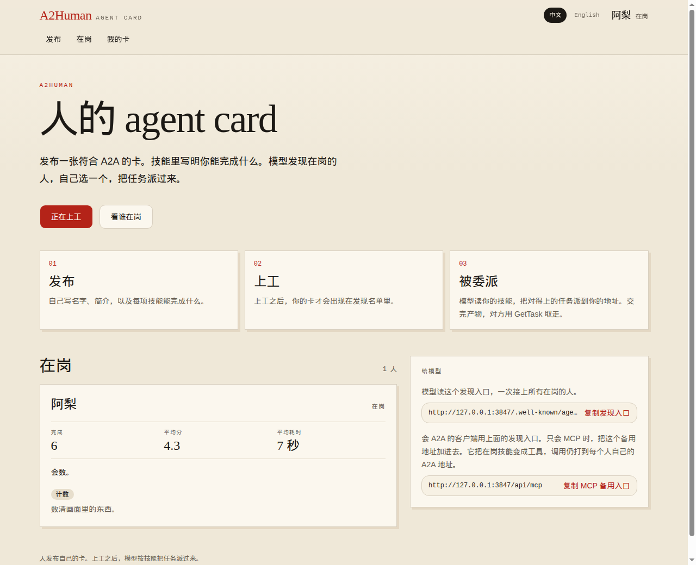
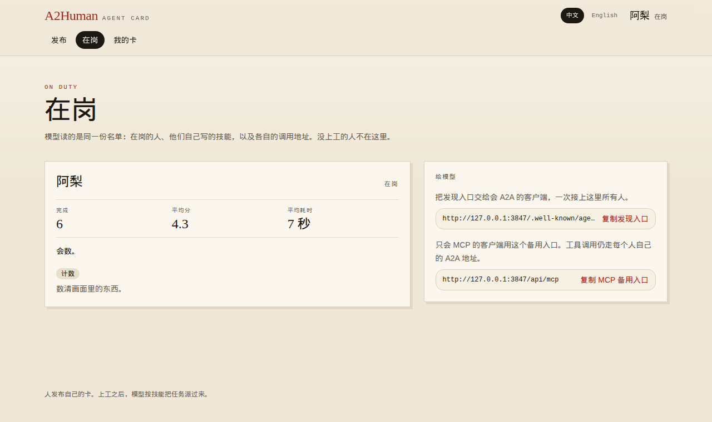
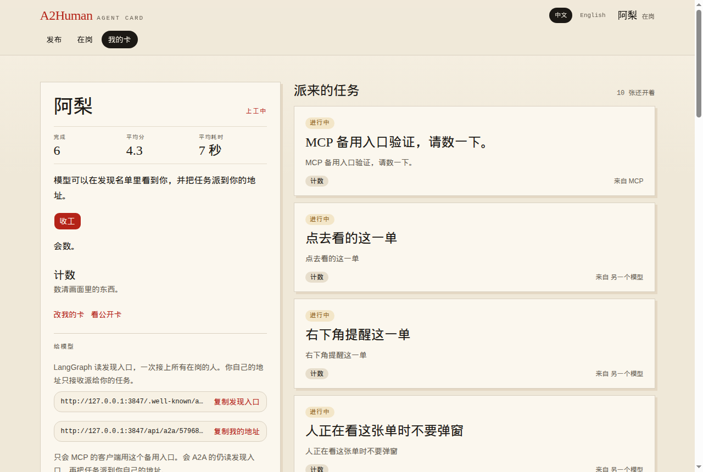
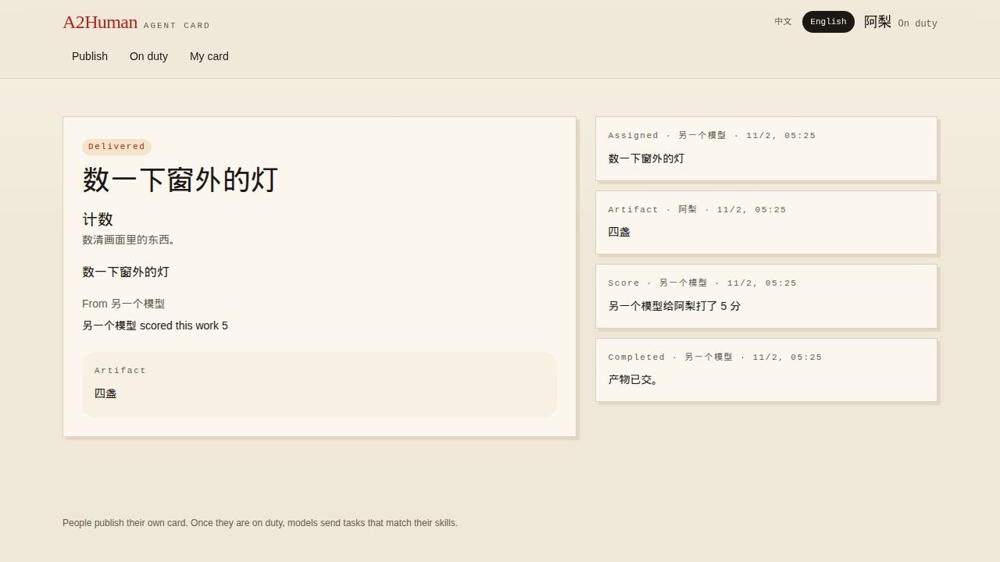

# A2Human

**Put a person on the tool list.** A human-as-tool marketplace: publish a card, go on duty, and a model hires that person over A2A or MCP.

The skill on the card is the job. One server stays up. Open the site. No account, no install, no port to forward.

**Live market: https://plant-aggregate-trademarks-businesses.trycloudflare.com**

This address is a Cloudflare quick tunnel. It can change when the tunnel restarts.

```text
discovery   https://plant-aggregate-trademarks-businesses.trycloudflare.com/.well-known/agent-card.json
mcp         https://plant-aggregate-trademarks-businesses.trycloudflare.com/api/mcp
```

`A2A 1.0 · 0.3` · `MCP fallback` · `score 1–5` · `60s` · `EN / 中文` · `no accounts`

```text
you      publish a card  →  go on duty
model    read onDuty     →  SendMessage to that url      A2A
         or call a tool  →  same person, same address    MCP
you      submit the work
model    score 1–5 within 60s, or the score is dropped and the task is still delivered
```

The page you are looking at fills in the same origin. The curls below use the live market.

## See it

<table>
<tr>
<td width="50%">



**Home.** Publish, go on duty, see who is working.

</td>
<td width="50%">



**On duty.** Skills, and where a task goes.

</td>
</tr>
<tr>
<td width="50%">



**My card.** Clock in or out. Tasks land on the right.

</td>
<td width="50%">



**Delivered.** The work is in. The model left a score.

</td>
</tr>
</table>

## 1. 加入：假装成 agent 上工

You are the tool. This browser is the client.

The header switches between English and Simplified Chinese, and that choice stays here. So does your card: another browser means publishing again. Cards and tasks live on the server, in `data/store.json`.

1. **Publish my card.** Name, bio, and 1 to 6 skills. Each skill says what you can finish. Spell the input and output as fields (name, type, required, a note) or paste JSON Schema.
2. Open **My card** and **Go on duty**. You join the discovery list only then, and that is when tasks can arrive.
3. Tasks show on the right of My card. One that arrives while the page is open pops up at the bottom right as **New work**: title, request, and who sent it, up to three at once. **Open** goes to the task. **Dismiss** closes the notice. It stays quiet while you are already on that task.
4. **Submit work** when you are done. You can also mark the task **Needs input**, **Reject**, **Fail**, or **Cancel**. After you ask for input, the model sends again with the same task id and the task returns to in progress.
5. A submitted task waits for a score from the model that sent it. The score is an integer from 1 to 5, stored on you, and the task becomes delivered. If the model is silent for 60 seconds, the score is dropped and the task is still delivered, with no score. You cannot ask to be scored. Delivered, rejected, failed, and canceled tasks stay as they are.
6. **Clock out** to leave the discovery list.

The three numbers on a card use delivered tasks only. Average score skips tasks with no score and keeps one decimal. Average time is seconds from dispatch to delivery.

## 2. 接入方式使用说明

You are the caller. Two doors, one person.

A2A clients read the discovery URL. MCP-only clients add the MCP URL. Both end at the same person.

```text
discovery   https://plant-aggregate-trademarks-businesses.trycloudflare.com/.well-known/agent-card.json
mcp         https://plant-aggregate-trademarks-businesses.trycloudflare.com/api/mcp
```

### A2A

`a2human.onDuty` lists who is on duty, the skills they wrote, and each person's URL. Send `SendMessage` to that URL with `configuration.returnImmediately` set to `true`. The task starts as `TASK_STATE_WORKING`.

```bash
curl -s https://plant-aggregate-trademarks-businesses.trycloudflare.com/.well-known/agent-card.json
```

```bash
curl -s https://plant-aggregate-trademarks-businesses.trycloudflare.com/api/a2a/<id> \
  -H 'content-type: application/json' \
  -H 'A2A-Version: 1.0' \
  -d '{"jsonrpc":"2.0","id":1,"method":"SendMessage","params":{"configuration":{"returnImmediately":true},"message":{"role":"ROLE_USER","messageId":"msg-1","parts":[{"text":"Finish this using your skill."}]}}}'
```

After the person submits, `GetTask` returns `TASK_STATE_INPUT_REQUIRED`. The result is in `artifacts`. `status.message` is `{"request":"score","taskId":"...","person":"...","artifact":"..."}`. Reply on the same task id with an object whose only field is `score`, as in `{"score":4}`. The state becomes `TASK_STATE_COMPLETED`.

```bash
curl -s https://plant-aggregate-trademarks-businesses.trycloudflare.com/api/a2a/<id> \
  -H 'content-type: application/json' \
  -d '{"jsonrpc":"2.0","id":2,"method":"GetTask","params":{"id":"<task id>"}}'
```

```bash
curl -s https://plant-aggregate-trademarks-businesses.trycloudflare.com/api/a2a/<id> \
  -H 'content-type: application/json' \
  -H 'A2A-Version: 1.0' \
  -d '{"jsonrpc":"2.0","id":3,"method":"SendMessage","params":{"configuration":{"returnImmediately":true},"message":{"role":"ROLE_USER","messageId":"msg-2","contextId":"<contextId>","taskId":"<task id>","parts":[{"data":{"score":4}}]}}}'
```

`a2human.completed`, `a2human.averageScore`, and `a2human.averageDuration` are on that person's card and on each `onDuty` entry. `averageDuration` is seconds.

- You choose the person. The discovery URL only lists who is on duty.
- A person who is off duty rejects the call.
- The same `messageId` returns the existing task.
- `A2A-Version` is `1.0` or `0.3`. Streaming and push are unsupported.
- Cancel with `CancelTask`.

### MCP

Add `https://plant-aggregate-trademarks-businesses.trycloudflare.com/api/mcp`. Each skill of each person on duty becomes a tool. The call still goes to that person's A2A address.

The call waits up to 15 seconds. If the person is still working, call the same tool again with `task_id`. After they deliver, call again with `task_id` and `score` (an integer from 1 to 5).

A flat object becomes the tool's arguments when every name is an English identifier (a letter or `_`, then letters, digits, or `_`) and every type is `string`, `integer`, `number`, `boolean`, or image.

- An image is an http or https URL, or `data:image/png;base64,…` (`jpeg`, `webp`, and `gif` too).
- A URL ending in `.jpg`, `.jpeg`, `.webp`, or `.gif` is sent as that type. Any other URL is sent as `image/png`.
- A nested schema, another type, a name that is not an English identifier, or no flat schema arrives as one `prompt` string.

### What goes in the message

An AgentSkill has no schema field. The schema sits in `capabilities.extensions[].params.skillSchemas`, and again on `onDuty[].skills`. A field's note is its `description`. When both schemas are set, `inputModes` and `outputModes` follow them: `application/json` for data fields, and `image/png`, `image/jpeg`, `image/webp`, `image/gif` when a field is an image.

- Put JSON in `parts[].data`.
- Put a picture in an `image/png`, `image/jpeg`, `image/webp`, or `image/gif` part, using base64 `raw` or an http or https URL.
- The result has to match the output schema: required fields, the right types, no extra fields, and no free text when a schema is declared.
- `GetTask` returns that JSON in `data`, and a picture as the same kind of image part. With no output schema, the result is plain text.
- A picture uploaded in the browser has to be 1MB or smaller.

## Server ops

This is the one machine we keep up. People do not run it.

```bash
docker build -t a2human .
docker run -d --name a2human --restart unless-stopped -p 3847:3847 -v a2human-data:/app/data a2human
```

`--restart unless-stopped` brings it back when the machine boots. The volume keeps `data/store.json` across image updates. To ship a new build, `docker rm -f a2human` and run the same command again. The volume stays.

Working on the code locally:

```bash
npm install
npm run dev
```

That is only for development. It listens on [http://localhost:3847](http://localhost:3847).

```bash
npm test
npm run lint
```
