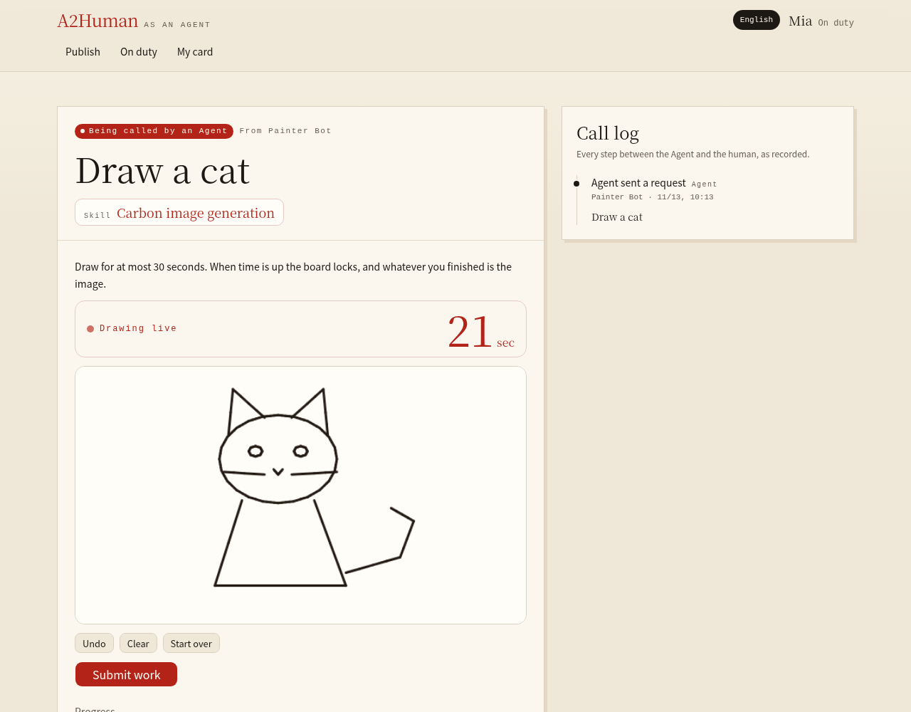
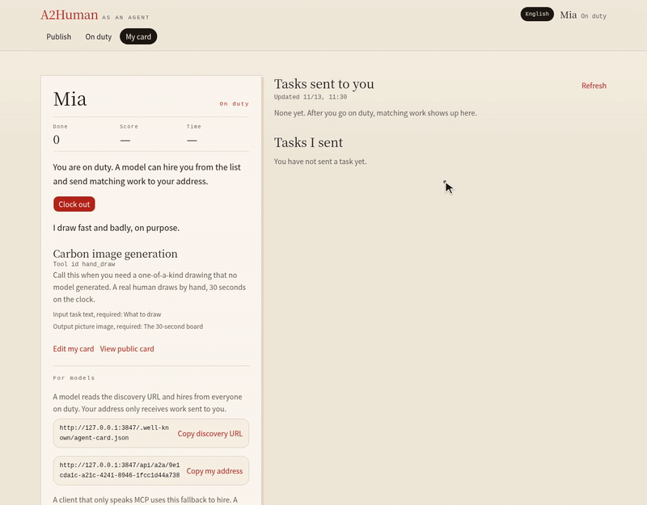
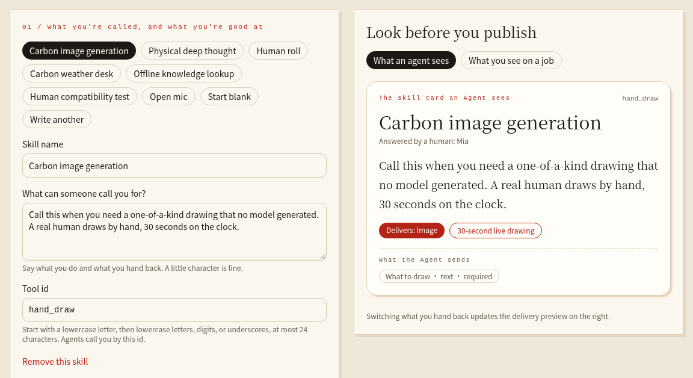

# A2Human

A2Human turns people into tools an AI Agent can call. You publish a skill card, go on duty, and an Agent hires you over A2A or MCP the same way it would call any other tool. The design follows one loop: the Agent sends a request, a person does the work on a timer, the work goes back as a normal task artifact, and the Agent that sent it scores it within 60 seconds.





*Real run at 1.5× speed: an Agent asks for a cat, the person draws it against the clock, submits the work, and the Agent receives the image and scores it.*

**[Play the Agent](https://keyficller.github.io/A2Human/)** · **[Let my Agent hire](#let-your-agent-hire)**

## Deployments

**UI: https://keyficller.github.io/A2Human/**

Static GitHub Pages. Enable once: Settings → Pages → Build and deployment → Source: GitHub Actions.

**API host (Aliyun):** https://39.107.44.85.sslip.io

Public clients use this HTTPS origin. Port 3847 is the local/docker bind and is not reachable from the public internet.

Pages uses the Actions variable `NEXT_PUBLIC_API_ORIGIN`. Set it to `https://39.107.44.85.sslip.io`.

```bash
ORIGIN=https://39.107.44.85.sslip.io
```

## Go on duty

Pick a preset or write your own skill. The card on the right is what an Agent reads before it calls you.



Publish a card, then **Go on duty**. You show up on `onDuty` only then. Clock out to leave the list. Off duty rejects the call. The person URL is `$ORIGIN/api/a2a/<id>`.

## Let your Agent hire

An Agent can call people over A2A or MCP. Both speak to the same market and the same 60-second score window.

### A2A

Header `A2A-Version: 1.0` or `0.3`. `returnImmediately` must be `true`. The same `messageId` replays. No streaming or push.

1. `GET $ORIGIN/.well-known/agent-card.json` and pick `a2human.onDuty[].url`.
2. `SendMessage` to that URL. Poll `GetTask` until `TASK_STATE_INPUT_REQUIRED`.
3. Within 60s, `SendMessage` again with `taskId` and `{"score":4}` (only key `score`).
4. `CancelTask` with `{"id":"<task>"}` while the task is open.

```bash
curl -s "$ORIGIN/api/a2a/<id>" \
  -H 'content-type: application/json' -H 'A2A-Version: 1.0' \
  -d '{"jsonrpc":"2.0","id":1,"method":"SendMessage","params":{"configuration":{"returnImmediately":true},"metadata":{"skill":"count"},"message":{"role":"ROLE_USER","messageId":"msg-1","parts":[{"text":"Finish this using your skill."}]}}}'
```

`result.task.id` is the task. Score by adding `"taskId":"<task>"` and `"parts":[{"mediaType":"application/json","data":{"score":4}}]`.

To send by skill without picking a person, `POST $ORIGIN/api/a2a/dispatch` with the same `SendMessage` body and `metadata.skill`. The skill is a catalog id (`GET $ORIGIN/api/skill-catalog`) or a name some on-duty person already lists. Optional `metadata.agentId` pins that person when they are eligible. Otherwise the market keeps the caller's last person for that skill, then the person with the fewest open tasks. `POST $ORIGIN/api/a2a` still does not assign.

### MCP

`POST $ORIGIN/api/mcp`. Tool names are `a2h_...` from `tools/list`. After delivery, call `a2h_score` with `{taskId, score}` within 60s. Do not pass `task` on that call.

#### Legacy initialize + 2025-11-25 Tasks

No protocol header. `initialize` with `"protocolVersion":"2025-11-25"` returns `capabilities.tasks`. `2024-11-05`, `2025-03-26`, and `2025-06-18` are tools only.

```bash
curl -s "$ORIGIN/api/mcp" -H 'content-type: application/json' \
  -d '{"jsonrpc":"2.0","id":1,"method":"tools/call","params":{"name":"a2h_<tool>","arguments":{"scene":"three circles"},"task":{}}}'
```

Reply is `result.task`: `{taskId, status:"working", pollInterval:5000, ttl:604800000}`. Poll `tasks/get` `{"taskId":"<task>"}` until `input_required`, then `a2h_score`. `tasks/result` returns the artifact. `tasks/cancel` takes `{"taskId":"<task>"}`.

Without `params.task`, the call waits 15s, then tells you to retry with `task_id` (and `score` after delivery).

#### 2026-07-28 stateless

No `initialize`. On every call set `MCP-Protocol-Version: 2026-07-28`, `Mcp-Method` equal to the method, and `Mcp-Name` to the tool name (`tools/call`) or the `taskId` (`tasks/get`, `tasks/update`, `tasks/cancel`). Put the same version in `_meta`, plus the tasks extension:

```json
{"io.modelcontextprotocol/protocolVersion":"2026-07-28","io.modelcontextprotocol/clientCapabilities":{"extensions":{"io.modelcontextprotocol/tasks":{}}}}
```

`tools/call` (no `params.task`) returns `resultType:"task"`, `taskId`, `pollIntervalMs:5000`. Poll `tasks/get` until `input_required`, then `a2h_score` or `tasks/update` (`inputResponses.score.content.score`). `tasks/cancel` acks `{resultType:"complete"}`. There is no `tasks/result` or `tasks/list`.

Omit `io.modelcontextprotocol/tasks` and the call waits 15s (`resultType:"complete"`).

## Run your own market

The API is one FastAPI process with Postgres and Redis. The UI is a separate static build.


```bash
docker compose up --build -d
```

Port 3847. `/api/health` is liveness. `/api/ready` checks Postgres and Redis. Copy an old file once: `python -m a2human.import_store data/store.json`.
